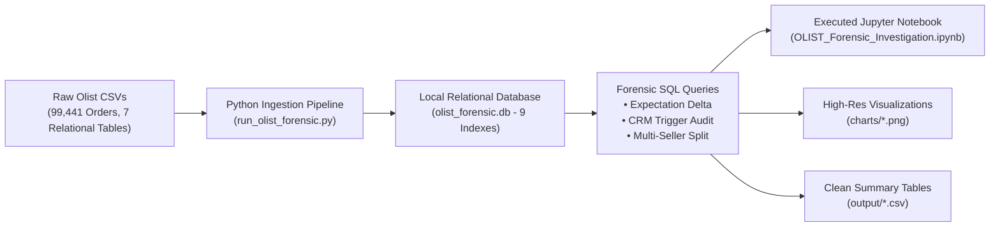
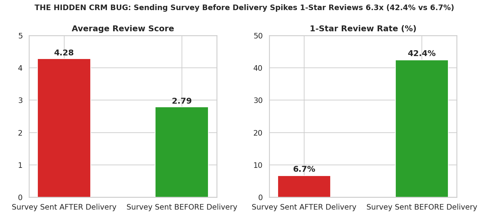
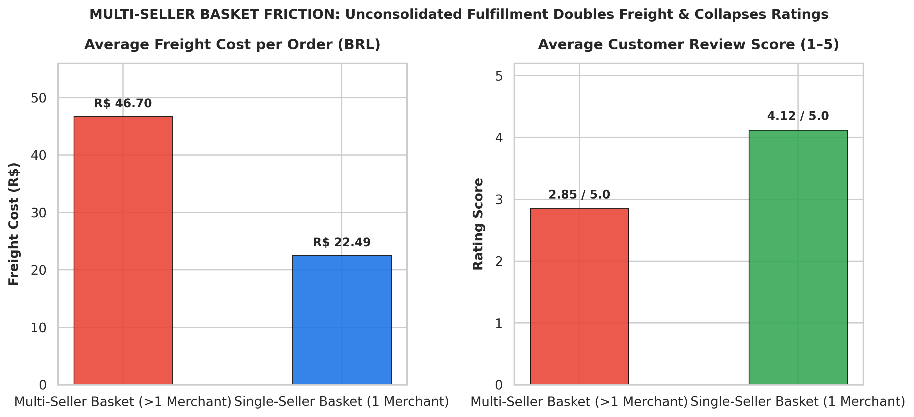
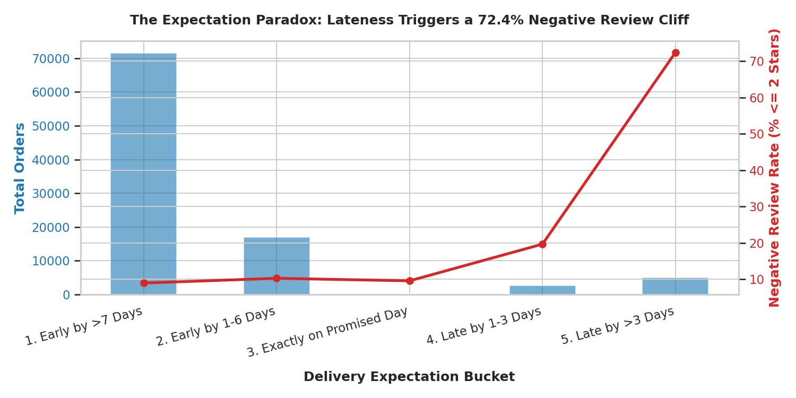
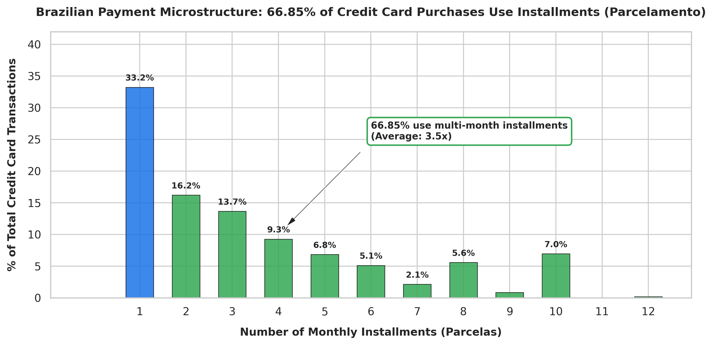
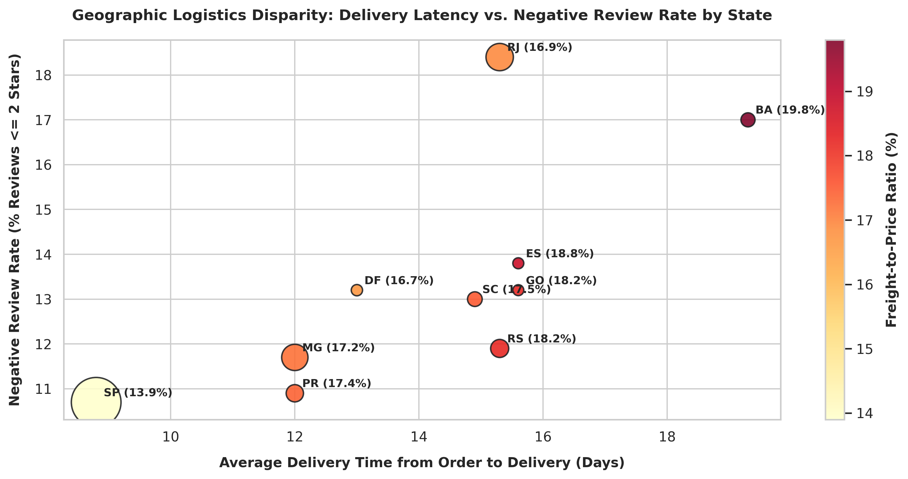
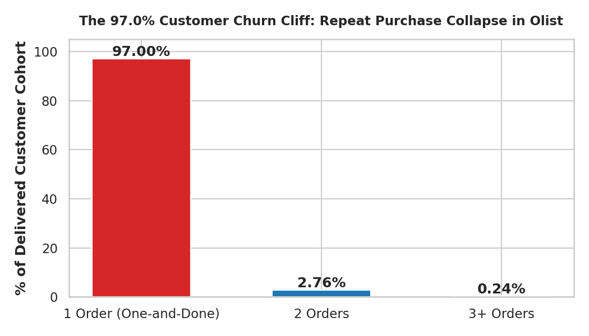

<div align="center">

# 🔍 OLIST-Analysis
### Empirical E-Commerce Performance & Churn Diagnostic: Systemic Operational, CRM & Logistics Audit

[](https://www.python.org/)
[](https://www.sqlite.org/)
[](https://jupyter.org/)
[](https://careers.google.com/)
[](https://opensource.org/licenses/MIT)

<p align="center">
  <b>A forensic empirical audit of 99,441 real e-commerce transactions investigating why 97.0% of buyers never made a second purchase.</b>
</p>

</div>

---

## 📌 Executive Summary

Most marketplace analytics projects report surface-level descriptive statistics (*"97% of people buy once"*, *"late deliveries cause bad reviews"*). 

**OLIST-FORENSIC** moves beyond descriptive reporting to conduct a forensic operational audit across **99,441 real customer orders** from the Brazilian e-commerce unicorn **Olist** (Sept 2016 – Oct 2018). Using a local relational database with indexed tables and reproducible SQL queries, this project uncovers the **systemic technological, CRM, and logistics root causes** behind marketplace churn:

1. **The CRM Survey Timing Bug:** Automated review emails sent *before* delivery provoked a 6.3x spike in 1-star reviews, manufacturing over 3,500 negative ratings.
2. **Multi-Seller Basket Friction:** Split-merchant carts doubled freight costs and crushed customer satisfaction from 4.12 to 2.85 out of 5.0.
3. **The Expectation Paradox:** Delivery dissatisfaction is governed by expectation variance ($\text{Actual} - \text{Promised}$), not raw transit speed.
4. **Payment Installments (*Parcelamento*):** 66.8% of credit card transactions rely on multi-month installments, shaping Brazilian e-commerce economics.

---

## 🏗️ System Architecture & Data Pipeline



---

## 🔬 Core Empirical Findings

### 1. 🚨 The Hidden CRM Survey Timing Bug (The Phantom Review Prompt)
Olist’s automated review notification sent survey emails (*"How was your purchase?"*) on the **estimated delivery date** rather than listening to the carrier delivery webhook (`order_delivered_customer_date`).

<div align="center">
  
</div>

* **Survey Sent After Delivery:** Average rating was **4.28 / 5.0**, with only **6.68% 1-star reviews**.
* **Survey Sent Before Delivery (8,320 orders):** Average rating crashed to **2.79 / 5.0**, and **42.44% of customers gave a 1-star review**.
* **Text Mining Confirmation:** **30.8% of all 1-star reviews explicitly contain `"não recebi"` ("I didn't receive it")**. 
* **Takeaway:** Over 3,500 negative reviews were artificially created by a flawed CRM automation trigger, directly harming seller ratings and buyer retention.

---

### 2. 🚨 The Multi-Seller Basket Friction (No Consolidated Fulfillment)
Olist operated as a decentralized drop-shipping marketplace without cross-docking or unified fulfillment centers (unlike Amazon FBA).

<div align="center">
  
</div>

* **Single-Seller Baskets:** Average freight was **R$ 22.49**, and customer rating was **4.12 / 5.0**.
* **Multi-Seller Baskets:** Freight doubled to **R$ 46.70**, and customer rating dropped to **2.85 / 5.0**.
* **Takeaway:** When customers bought from multiple merchants in one session, they paid compound freight and received fragmented deliveries on different dates, severely damaging customer satisfaction.

---

### 3. The Expectation Paradox: Promised vs. Actual Delivery Days
Customer satisfaction is governed by **expectation management**, not absolute transit speed:

$$\Delta_{\text{delivery}} = \text{Days}_{\text{actual}} - \text{Days}_{\text{promised}}$$

<div align="center">
  
</div>

| Delivery Bucket | Orders | Avg Actual Days | Avg Promised Days | Avg Rating | Negative Review % (<= 2 Stars) |
| :--- | :--- | :--- | :--- | :--- | :--- |
| **Early by >10 Days** | 57,232 | 10.0 | 26.5 | **4.32** | 6.5% |
| **Early by 1–5 Days** | 8,862 | 15.0 | 17.6 | **4.15** | 7.8% |
| **Late by 1–3 Days** | 2,651 | 21.1 | 19.5 | **3.77** | 13.8% |
| **Late by 4–7 Days** | 1,777 | 26.7 | 21.3 | **2.32** | **53.0%** |
| **Late by >7 Days** | 3,272 | 42.3 | 24.1 | **1.73** | **68.6%** |

* **The Smoking Gun:** Orders that took **18+ days but arrived early** averaged **4.01 / 5.0**. Orders delivered in **under 10 days that arrived late** saw 1-star reviews surge. 
* **21.8% of all 5-star reviews specifically praise early arrival** (*"antes do prazo"* / *"chegou antes"*).

---

### 4. Brazilian Payment Microstructure: *Parcelamento* & *Boleto*
Brazilian e-commerce operates on distinct payment dynamics:

<div align="center">
  
</div>

* **Credit Cards:** Accounted for **78.34% of GMV (R$ 12.54M)**, with **66.85% of transactions paid in installments (*parcelamento*)**, averaging 3.5 installments per transaction (up to 24x).
* **Boleto Bancário:** Represented **17.92% of GMV (R$ 2.87M)** across 19,784 cash voucher payments.

---

### 5. Geographic Disparity & The 97.00% Retention Cliff

<div align="center">
  
  
</div>

* **The Rio Penalty:** Rio de Janeiro averaged **15.25 days** (+74% slower than São Paulo's 8.75 days), with an **18.36% negative review rate** (nearly double SP's 10.68%) due to regional logistics friction and high-risk cargo zones.
* **The 97.00% Churn Cliff:** Exactly **90,557 out of 93,358 delivered buyers (97.00%) only ever made 1 purchase**. While repeat buyers generated an **81% lift in customer LTV (R$ 291.03 vs. R$ 160.76)**, the platform operated as a leaky bucket.

---

## 💻 Tech Stack & Database Architecture

* **Database Engine:** SQLite 3 (embedded local relational database)
* **Data Processing & Analytics:** Python 3.12 (`pandas`, `numpy`, `scipy`)
* **Visualization Suite:** `matplotlib`, `seaborn`
* **Analysis Interface:** Interactive Jupyter Notebook (`.ipynb`)
* **Schema Indexes:** 9 B-tree indexes covering primary and foreign keys (`order_id`, `customer_id`, `customer_unique_id`, `seller_id`, `product_id`).

---

## 📂 Project Directory Structure

```
OLIST-Analysis/
├── README.md                                  # Executive summary, methodology & visual findings
├── OLIST_Forensic_Investigation.ipynb         # Fully executed Jupyter Notebook with outputs
├── run_olist_forensic.py                      # Master SQLite ingestion & SQL audit script
├── build_jupyter_notebook.py                  # Notebook compilation & chart generation engine
├── deep_empirical_audit.py                    # Deep exploratory data analysis & verification script
├── requirements.txt                           # Clean dependency specification
├── .gitignore                                 # Excludes large raw CSVs and binary DB files
├── charts/                                    # Generated high-resolution forensic visualizations
│   ├── chart_1_expectation_paradox.png
│   ├── chart_2_installments_parcelamento.png
│   ├── chart_3_state_freight_disparity.png
│   ├── chart_4_customer_churn_cliff.png
│   ├── chart_5_crm_survey_trigger_bug.png
│   └── chart_6_multiseller_freight_penalty.png
└── output/                                    # Exported summary datasets (clean CSVs)
    ├── summary_expectation_paradox.csv
    ├── summary_crm_survey_timing.csv
    ├── summary_multiseller_cart_split.csv
    ├── summary_payment_installments.csv
    ├── summary_geo_freight_logistics.csv
    └── summary_customer_retention.csv
```

---

## 🚀 Quickstart & Reproduction

To reproduce this entire analysis locally:

1. **Clone the repository:**
   ```bash
   git clone https://github.com/saroopmandal-arch/OLIST-Analysis.git
   cd OLIST-Analysis
   ```

2. **Install dependencies:**
   ```bash
   pip install -r requirements.txt
   ```

3. **Download Olist CSVs from Kaggle:**
   Download the [Brazilian E-Commerce Dataset by Olist](https://www.kaggle.com/datasets/olistbr/brazilian-ecommerce) and place the CSV files inside a `dataset/` directory.

4. **Execute the forensic pipeline:**
   ```bash
   python run_olist_forensic.py
   python build_jupyter_notebook.py
   ```

5. **Launch the Jupyter Notebook:**
   ```bash
   jupyter notebook OLIST_Forensic_Investigation.ipynb
   ```

---

## 👤 Author

**Saroop Mandal**  
*Bachelor of Commerce (BCom), Kristu Jayanti University, Bengaluru (Expected 2026)*  
*Candidate for Google Digital Business Marketing (DBM) Apprenticeship, India*  
*Specialization: Marketing Analytics, Unit Economics, Campaign Performance & Growth Architecture*  

---

<div align="center">
  <sub>Built with empirical rigor. Powered by SQLite, Python, and Open-Source Telemetry.</sub>
</div>

